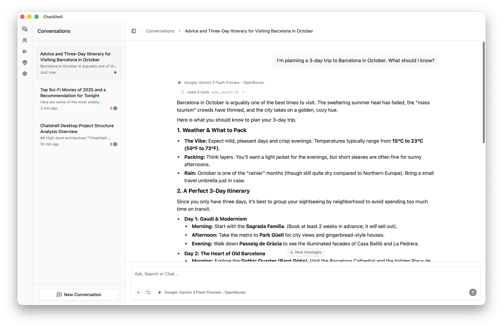
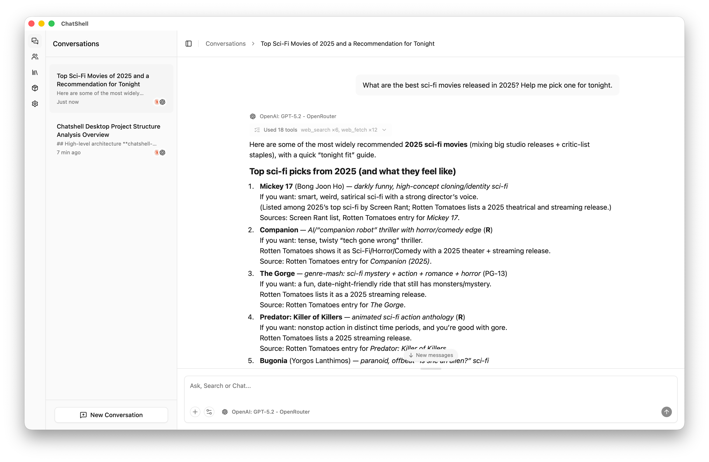
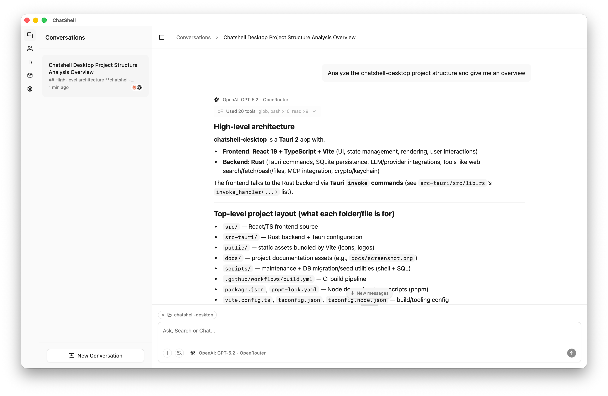

# ChatShell

Give any AI model, cloud or local, web search, file access, and a shell on your desktop, with nothing extra to set up.

**Status:** In active development. Features and behavior may change between releases.

[](https://github.com/chatshellapp/chatshell-desktop/releases/latest) [](https://github.com/chatshellapp/chatshell-desktop/releases/latest)

Connect a cloud AI provider or a local model, then use it to research topics, work with files, and run commands. Built-in tools work without plugins or MCP servers; additional integrations are optional.

Available for macOS, Windows, and Linux. Licensed under [Apache 2.0](LICENSE).

[Download ChatShell](https://github.com/chatshellapp/chatshell-desktop/releases/latest) · [Documentation](https://chatshell.app/docs)

---

## Quick Start

1. [Download and install ChatShell](https://github.com/chatshellapp/chatshell-desktop/releases/latest) for your platform. The Windows installer is not code-signed yet, so SmartScreen may warn on first run: choose **More info**, then **Run anyway**.
2. Connect an AI provider with your API key (a ChatGPT or Claude subscription cannot be used here), or configure a local model through Ollama or LM Studio.
3. Select a model that supports tool use, then send:

```text
Find things to do in Kyoto on a rainy day and group them by neighborhood.
```

ChatShell can use its built-in search and fetch tools to gather information and return a summary. New conversations start in Ask mode, which confirms file changes and risky commands before they run. Switch to Auto or Yolo in the chat input toolbar, or change the default in Settings → Permissions.

---

## Why ChatShell?

- **Tools work on first launch:** Web search, page fetching, file reading and editing, and shell commands are built in. Search defaults to DuckDuckGo, with all engines switchable in Settings, so there is no search API key to get. MCP servers are optional.
- **Bring any model:** Connect cloud providers with your own API key, or run local models through Ollama or LM Studio. You pay your provider directly, per use.
- **You decide what runs:** New conversations start in Ask mode. Shell commands run inside the OS sandbox (macOS Seatbelt, Linux bubblewrap), and anything that leaves it, edits a file, or calls another tool waits for your approval; where no sandbox is available, shell commands are confirmed too. Auto mode lets the model review each action and run the safe ones without asking. Yolo runs everything without asking or a sandbox. Catastrophic commands such as `rm -rf /` are blocked in every mode.
- **History stays on your device:** Conversations are stored in SQLite locally. Cloud providers receive what you send them; optional iCloud sync uploads encrypted copies.

**When to use something else:** If you would rather not manage API keys, the official ChatGPT or Claude desktop apps give you their models on a flat subscription, with vendor features such as memory and voice. If you want a longer-established client with a larger community, try Cherry Studio, Msty, or Chatbox.

---

## Security and Data

- **No telemetry:** ChatShell sends no usage data. Update checks go to `dl.chatshell.app`, with GitHub Releases as a fallback.
- **Where data goes:** Conversations stay in local SQLite. Cloud providers receive only what you send them. Optional iCloud sync uploads encrypted copies.
- **Agent boundaries:** The assistant cannot read ChatShell's own data folder, asks before reading shell configuration files, and in Ask and Auto modes runs shell commands inside the OS sandbox where one is available.
- **Secrets:** API keys and MCP tokens are encrypted with AES-256-GCM; the master key is held in the OS credential store.
- **Builds:** macOS builds are signed and notarized by Seedvector LLC. Updates are signature-verified before install. Windows builds are not yet code-signed.
- **Support:** ChatShell is maintained by Seedvector LLC. [GitHub issues](https://github.com/chatshellapp/chatshell-desktop/issues) get a first response within a week.
- **Reporting vulnerabilities:** See [SECURITY.md](SECURITY.md).

---

## Example Tasks

Try these prompts with a model that supports tool use:

- **Plan a trip:** `Find things to do in Kyoto on a rainy day and group them by neighborhood.`
- **Choose a purchase:** `Compare three robot vacuums under $400, including recurring costs and common complaints.`
- **Plan meals:** `Suggest five dinners for two using rice, eggs, spinach, and chicken. Save a shopping list for anything else needed.`
- **Organize files:** `Look through my Downloads folder and suggest how to organize it. Wait for my approval before moving anything.`

Results depend on the selected model, enabled tools, and available permissions.

See [more example tasks](docs/example-tasks.md) for research, coding, automation, and creative prompts.

---

## Screenshots



<details>
<summary>More screenshots</summary>





</details>

---

## More Features

- **Keep conversations useful:** Search past messages, branch a conversation, and export replies as Markdown or images.
- **Work with attachments:** Add documents, PDFs, spreadsheets, data files, images, videos, folder listings, and web pages, or type @ to attach a file from the working directory. Image understanding and generation require compatible models.
- **Review file changes:** Each reply lists the files it created or modified, and you can undo a turn's file changes.
- **See results visually:** Replies can include charts, KPI cards, SVG figures, Mermaid diagrams, and math.
- **Translate text:** Translate in a full-page view with source and result side by side, keep a history on this device, then continue in a conversation for follow-up questions.
- **Reuse your setup:** Save prompts and assistants for tasks you do regularly.
- **Extend it:** Add reusable instructions through skills, or connect external tools through the Model Context Protocol (MCP).
- **Sync optionally:** Sync encrypted conversation history and attachments through iCloud Drive on supported macOS and iOS builds.

See the [feature guide](docs/features.md) for tool details, provider configuration, skills, integrations, and storage behavior.

---

## Resources

- [Documentation](https://chatshell.app/docs)
- [Development and contributing](CONTRIBUTING.md)
- [Report a bug](https://github.com/chatshellapp/chatshell-desktop/issues)
- [Report a security vulnerability](SECURITY.md)
- [Apache 2.0 license](LICENSE)
- [Acknowledgements](docs/acknowledgements.md)
